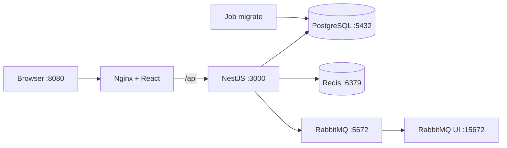
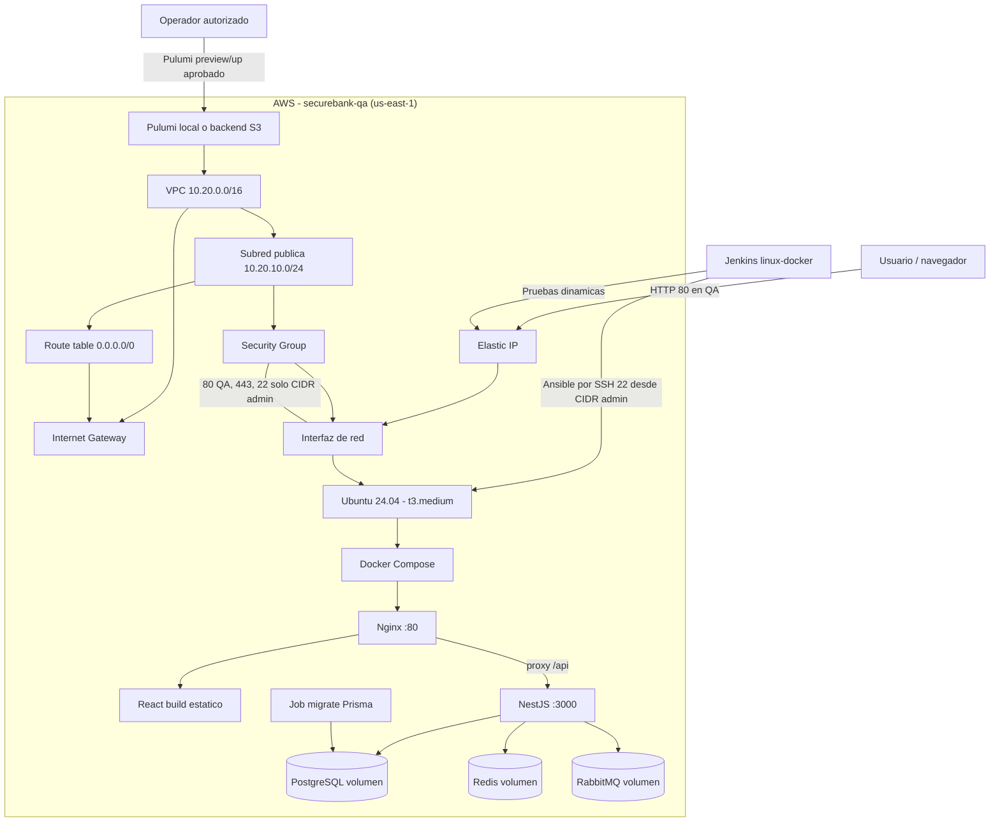

# Arquitectura DevOps de SecureBank

SecureBank se despliega como un **monolito modular NestJS** con frontend React,
PostgreSQL, Redis y RabbitMQ. No se introducen microservicios: los módulos de
dominio (`auth`, `accounts`, `beneficiaries`, `transfers`, `payments`) comparten
un único proceso y una única imagen de backend.

## Arquitectura local integrada

Todos los servicios están en la red privada `securebank-net`. En desarrollo
solo se publican puertos en `127.0.0.1`; PostgreSQL, Redis y RabbitMQ nunca se
exponen fuera del host.

## Arquitectura QA en AWS

La IP elástica es estática y el security group solo abre SSH al CIDR
administrativo. En QA se abre HTTP porque todavía no hay certificado TLS.
Producción solo abre 443 y requiere terminación TLS antes del despliegue final.
La infraestructura activa se define en `infrastructure/pulumi` (Pulumi/TypeScript);
el módulo `infrastructure/terraform` se conserva como legado de referencia Azure.

### Puertos y exposición

| Puerto | Servicio | Exposición | Notas |
|---|---|---|---|
| 80 | Nginx / frontend | Pública en QA | `FRONTEND_BIND_ADDRESS=0.0.0.0`, `FRONTEND_PORT=80` |
| 443 | Nginx | Pública, pendiente TLS | El security group lo permite; falta certificado |
| 22 | SSH | Solo `allowedSshCidr` (recomendado /32) | Nunca `0.0.0.0/0` |
| 3000 | NestJS | Loopback en la VM | Nginx es el único punto de entrada |
| 5432 | PostgreSQL | Red Docker; `127.0.0.1:5433` en el host | Sin publicación pública |
| 6379 | Redis | Red Docker; `127.0.0.1:6379` en el host | Sin publicación pública |
| 5672/15672 | RabbitMQ | Red Docker; loopback en el host | Sin publicación pública |

### Costos estimados (`us-east-1`)

Precios públicos consultados el 2026-11-05, sin impuestos, créditos ni
transferencia de datos:

| Recurso | Estimado mensual |
|---|---|
| `t3.medium` Linux (2 vCPU, 4 GB) | ~USD 30.37 |
| EBS gp3 30 GB | ~USD 2.40 |
| IPv4 pública / Elastic IP | ~USD 3.65 |
| **Total aproximado** | **~USD 36.42/mes** |

`t3.large` (2 vCPU, 8 GB) es recomendable si se compilan imágenes en la VM:
total aproximado ~USD 66.79/mes. Ver
[`infrastructure/pulumi/README.md`](../infrastructure/pulumi/README.md).

## Flujo de despliegue

### Frontend web

1. Jenkins ejecuta `npm ci`, lint, typecheck, pruebas y build de Vite.
2. La imagen multi-stage `frontend/Dockerfile` copia `dist/` a Nginx.
3. Nginx sirve la SPA y hace proxy de `/api/` hacia `backend:3000`.
4. `absolute_redirect off` conserva el puerto publicado en redirecciones.

### Backend

1. Jenkins ejecuta pruebas unitarias y build de NestJS.
2. La imagen runtime usa `npm ci --omit=dev` y corre como usuario `node`.
3. El job `migrate` usa el target de build con Prisma CLI y ejecuta
   `prisma migrate deploy` antes de levantar la aplicación.
4. El backend se conecta a PostgreSQL, Redis y RabbitMQ por la red privada.

### Aplicación móvil

La app Expo/React Native consume la misma API; no se despliega en la VM.

1. Configurar `EXPO_PUBLIC_API_URL=https://<host-publico>/api` (o HTTP en QA).
2. Compilar el binario con EAS/Expo o generar el APK en el pipeline móvil.
3. Ejecutar los flujos Maestro contra un emulador o dispositivo.
4. Para QA, el teléfono debe alcanzar la IP pública de la VM. En producción se
   requiere HTTPS y una URL estable.

## Seguridad

- Secretos de aplicación fuera de la infraestructura: Ansible Vault o
  credenciales Jenkins.
- `ansible/inventory/group_vars/all.yml` se carga junto al inventario; Jenkins lo
  materializa desde la credencial cifrada y lo elimina al finalizar.
- `.env`, `Pulumi.qa.yaml`, la passphrase de Pulumi, inventarios reales y claves
  privadas están ignorados por Git.
- La clave SSH privada permanece en `~/.ssh/securebank_qa`; solo la pública se
  registra en el key pair de EC2 mediante Pulumi.
- La instancia deshabilita autenticación por contraseña, exige IMDSv2 y usa un
  volumen EBS cifrado.
- Los logs de Docker rotan a 10 MB × 3 archivos.
- Los contenedores de datos conservan volúmenes persistentes; nunca se usa
  `docker compose down -v` en operación normal.

## Jenkins

El pipeline declarativo contiene las etapas solicitadas:

| Etapa | Estado por defecto | Requisito externo |
|---|---|---|
| Checkout, Pulumi Validate | Activa | Agente `linux-docker`, Node.js 22 y Pulumi 3.27x (sin credenciales AWS) |
| Pulumi Preview | Desactivada | Sesión AWS válida, backend/stack Pulumi, `pulumi-config-passphrase`; nunca aplica |
| Dependencies, Lint, Unit tests | Activa | Agente `linux-docker`, Node.js 22 |
| SonarQube + Quality Gate | Desactivada | Servidor SonarQube, plugin y `sonar-scanner` |
| npm audit | Activa | Bloquea ante vulnerabilidades críticas |
| OWASP Dependency-Check | Desactivada | Imagen Docker y credencial `nvd-api-key` |
| Fortify | Desactivada | Licencia y `sourceanalyzer` |
| Docker Build | Activa | Docker Compose v2 |
| Deploy QA | Desactivada | Aprobación, SSH, Ansible Vault, `securebank-qa-vars`, VM QA |
| API tests | Activa tras Deploy QA | `tests/api/smoke.mjs` |
| Cypress | Desactivada | `cypress/included`, `QA_BASE_URL` |
| Maestro | Desactivada | Emulador/dispositivo y CLI Maestro |
| ZAP | Desactivada | `zap-stable`, `QA_BASE_URL` |
| Performance | Desactivada | `grafana/k6`, `QA_BASE_URL` |
| Quality Gate | Desactivada | SonarQube |
| Approval + Deploy final | Desactivada | Aprobación manual y credenciales finales (`securebank-final-vars`) |

Las etapas desactivadas se omiten; si se habilitan y la herramienta no está
instalada, fallan con un mensaje explícito. No se generan resultados simulados.

Ver [JENKINS-SETUP.md](JENKINS-SETUP.md) para plugins, credenciales y agentes.

## Producción

Antes de producción se requiere: backend remoto Pulumi (por ejemplo S3) con
bloqueo, AWS Secrets Manager o SSM Parameter Store para secretos,
TLS/certificados, copia de seguridad y recuperación de PostgreSQL, monitoreo,
alertas, rotación de credenciales y sustitución de servicios de datos locales
por servicios administrados o un plan operativo equivalente.
